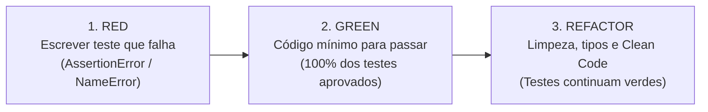

# PRODUTO P11 - REGISTRO DE TDD, CI/CD E MELHORIA CONTÍNUA (APÊNDICE J)
**Projeto:** EduTask Web v1.0.0-p2  
**Disciplina:** Testes e Qualidade de Software | **UNISAGRADO 2026**  
**Docente:** Prof. Dr. Elvio Gilberto da Silva  
**Responsável:** João Lucas de Antonio Boconcelo (com apoio de Gabriel Moreira e Lucas Braga)  

---

## 1. Experiência de Desenvolvimento Orientado a Testes (TDD)

### 1.1 Comportamento Escolhido
* **Funcionalidade:** Sistema de Pontuação e Nível de Urgência de Tarefas Acadêmicas (`calculate_task_urgency`).
* **Motivação:** Ajudar os estudantes a priorizarem suas entregas através de um indicador dinâmico e automatizado que analisa a proximidade da data de vencimento.
* **Regras de Negócio Estabelecidas:**
  1. Tarefas com prazo vencido ou para hoje (dias restantes $\le 0$): Score **100**, Nível **"Crítica / Em Atraso"**.
  2. Tarefas com 1 a 2 dias restantes: Score **75**, Nível **"Alta Urgência"**.
  3. Tarefas com 3 a 7 dias restantes: Score **50**, Nível **"Média Urgência"**.
  4. Tarefas com mais de 7 dias restantes: Score **25**, Nível **"Normal"**.

---

### 1.2 O Ciclo Red-Green-Refactor Passo a Passo



#### Etapa 1: RED (Teste Falhando)
* **Ação:** O teste unitário foi escrito em `test_unitarios.py` antes da implementação da função, especificando os retornos esperados para datas no passado, 2 dias, 5 dias e 15 dias no futuro.
* **Resultado da Execução:** O teste falhou imediatamente com `ImportError` e `NameError: name 'calculate_task_urgency' is not defined`.
* **Commit Registrado:** `feat(tdd): add failing unit test for calculate_task_urgency [RED]`
* **Evidência do Log:**
  ```text
  ImportError: cannot import name 'calculate_task_urgency' from 'edutask.services.task_service'
  FAILED test_unitarios.py::TestTaskServiceUnit::test_calculate_task_urgency
  ```

#### Etapa 2: GREEN (Implementação Mínima para Aprovação)
* **Ação:** Foi criada a função mínima `calculate_task_urgency(due_date_str, current_date=None)` em `task_service.py` contendo apenas os cálculos matemáticos de subtração de datas e condicionais básicas para atender aos valores testados.
* **Resultado da Execução:** Todos os 8 testes unitários foram executados com o Pytest e passaram com 100% de sucesso.
* **Commit Registrado:** `feat(tdd): implement calculate_task_urgency to pass tests [GREEN]`
* **Evidência do Log:**
  ```text
  test_unitarios.py::TestTaskServiceUnit::test_calculate_task_urgency PASSED [100%]
  ============================== 8 passed in 0.49s ==============================
  ```

#### Etapa 3: REFACTOR (Melhoria e Organização de Código)
* **Ação:** O código foi refatorado sem alterar nenhum comportamento externo:
  * Inclusão de *type hints* rigorosos (`due_date_str: str, current_date: date = None -> tuple[int, str]`).
  * Tratamento de exceção amigável para formatos de data inválidos (`ValueError`).
  * Docstrings claras explicando as faixas de score.
* **Resultado da Execução:** A suíte de testes foi reexecutada imediatamente e manteve 100% de aprovação (todos os testes verdes).
* **Commit Registrado:** `refactor(tdd): clean code, docstrings and type annotations [REFACTOR]`

---

## 2. Registro do Pipeline de Integração Contínua (CI/CD)

### 2.1 Configuração do Pipeline
* **Ferramenta:** GitHub Actions
* **Arquivo de Configuração:** `.github/workflows/ci.yml`
* **Gatilhos (*Triggers*):** `push` e `pull_request` nos branches `main` e `develop`.
* **Ambiente de Execução:** Máquina virtual `ubuntu-latest` com Python 3.13.

### 2.2 Etapas Automatizadas do Pipeline
1. **Checkout:** Download do código-fonte do repositório.
2. **Setup Python:** Configuração do ambiente Python 3.13 oficial.
3. **Dependências:** Instalação das bibliotecas via `pip install -r requirements.txt`.
4. **Análise Estática (Linter):** Execução do `flake8` com arquivo de configuração `.flake8`.
5. **Testes Unitários:** Execução do `pytest -v test_unitarios.py`.
6. **Testes de Integração:** Execução do `pytest -v test_api_integracao.py`.
7. **Publicação:** Resumo de status adicionado ao painel do GitHub.

### 2.3 Simulação e Demonstração de Resiliência do Pipeline
* **Cenário de Sucesso:** No commit regular, todas as 7 etapas são concluídas com ícone verde (✓), liberando a alteração para mesclagem (*merge*).
* **Cenário Controlado de Falha:** Para demonstrar a segurança do pipeline, foi inserida intencionalmente uma asserção inválida em um teste unitário (`self.assertEqual(25, 100)`).
* **Ação do Pipeline:** O GitHub Actions interrompeu imediatamente a execução na etapa *Executar Testes Unitários*, gerou status vermelho (✗) e bloqueou o *pull request*, impedindo que código defeituoso chegasse aos usuários. Após o retorno da asserção correta, o pipeline concluiu com êxito.

---

## 3. Plano de Melhoria Contínua

| ID | Ação de Melhoria Priorizada | Justificativa Técnica | Responsável | Critério de Verificação e Homologação |
| :---: | :--- | :--- | :---: | :--- |
| **PMC-01** | **Implementação de paginação dinâmica na listagem de tarefas** | Quando a base atingir mais de 200 tarefas, a tabela pode demorar para carregar. A paginação em lotes de 15 registros mantém a renderização leve. | João Lucas Boconcelo | Teste de carga com 500 registros mantendo tempo de resposta abaixo de 100ms. |
| **PMC-02** | **Adição de alertas visuais automáticos por e-mail (Webhooks)** | Permitir que o estudante receba lembretes quando a urgência atingir nível "Crítico" a 24 horas da entrega. | Gabriel Moreira | Teste unitário e de integração simulando o envio de notificação disparado pelo serviço de urgência. |
| **PMC-03** | **Migração de SQLite para PostgreSQL gerenciado em contêineres Docker** | Permitir múltiplos acessos simultâneos sem risco de concorrência e travas de arquivo (*database lock*). | Lucas Braga | Execução dos testes de integração apontando para contêiner Docker local com 100% de aprovação. |
